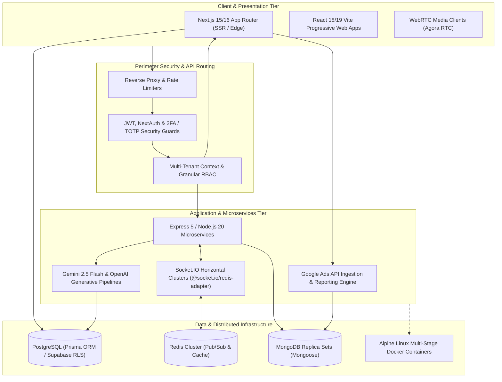

# 👨‍💻 Danish Ajmal
### Full-Stack Systems Engineer · TypeScript | Next.js | Node.js | Distributed Systems

  
  
  
  

 

> **Software Engineer** specializing in full-stack architecture, high-concurrency Node.js/TypeScript distributed systems, Next.js SSR applications, and multi-tenant platforms. Experienced in architecting production solutions spanning Redis pub/sub WebSocket clusters, WebRTC media streaming, relational & document data modeling (PostgreSQL, MongoDB), and generative AI workflows.

---

## 🏛️ End-to-End Systems Engineering Blueprint

---

## 🚀 Flagship Production Systems

| System | Role & Architectural Pattern | Tech Stack | Repository |
|---|---|---|---|
| **Ember & Grain** | Multi-Role Restaurant Management Platform featuring real-time kitchen display systems, driver dispatch, and Gemini 2.5 Flash demand forecasting | Next.js 15, TypeScript, PostgreSQL, Prisma ORM, Gemini AI, Docker, pnpm | [View Repo ↗](https://github.com/DanishAjma1/AI-Driven-Resturant) |
| **TrustBridge Backend** | Distributed Real-Time Financial & Deal Engine with Redis pub/sub WebSocket clustering, WebRTC video calling, and Stripe escrow payments | Node.js, Express 5, Redis, Socket.IO, MongoDB, Agora RTC, Stripe, OpenAI | [View Repo ↗](https://github.com/DanishAjma1/TrustBridgeAI-Backend) |
| **TrustBridge UI** | Enterprise Investor Collaboration PWA with interactive term-sheet negotiation modals, real-time messaging, and Agora WebRTC video | React 18, Vite 5, TypeScript, WebRTC Agora, Socket.IO, Stripe, PWA, Vitest | [View Repo ↗](https://github.com/DanishAjma1/TrustBridge-AI) |
| **Harmony School Hub** | Multi-Tenant School ERP SaaS with dynamic institutional branding, automated fee billing, and PostgreSQL Row-Level Security | TanStack Start, React 19, Nitro Engine, Supabase, PostgreSQL RLS, Tailwind v4 | [View Repo ↗](https://github.com/DanishAjma1/harmony-school-hub) |
| **Ads CRM** | Full-Stack Advertising Intelligence CRM with Google Ads API v23 real-time ingestion, automated reporting, and NextAuth RBAC | Next.js 16, React 19, TypeScript, Google Ads API, MongoDB, NextAuth, Recharts | [View Repo ↗](https://github.com/DanishAjma1/CRM) |
| **Muhammadi Studio** | Media Pipeline & Booking Platform featuring Bun runtime, TanStack Table schedule matrix, and ExcelJS automated ledger export | Next.js 16, React 19, Bun Runtime, TanStack Table, ExcelJS, Nodemailer SMTP | [View Repo ↗](https://github.com/DanishAjma1/muhammadi-studio) |

---

## ⚡ Core Engineering & Performance Capabilities

- **Horizontal WebSocket Scaling**: Engineered multi-node WebSocket clusters using `@socket.io/redis-adapter` and Redis pub/sub channels to ensure sub-50ms message broadcast latency across distributed server instances.
- **Strict Multi-Tenant Data Isolation**: Implemented multi-tenant architectures enforcing data isolation at both the application level (tenant context middleware) and database level (PostgreSQL Row-Level Security policies).
- **Predictive AI Pipelines**: Built asynchronous inference pipelines integrating Google Gemini 2.5 Flash and OpenAI GPT models for inventory demand forecasting and automated deal viability scoring.
- **Containerized CI/CD & Production Hardening**: Author of multi-stage Alpine Linux Dockerfiles reducing container image footprints under 120MB with standalone Next.js compilation and GitHub Actions CI pipelines.

---

## 🛠️ Technical Arsenal

### Languages & Core Runtimes

  
  
  
  
  

### Frontend & SSR Architectures

  
  
  
  
  
  

### Backend, Real-Time & Distributed Systems

  
  
  
  
  
  

### Databases & ORMs

  
  
  
  

### DevOps, Testing & Cloud

  
  
  
  
  

---

## 📈 Engineering Contributions

  
  

---

## 💬 Let's Connect & Build
- 🌐 **Portfolio**: [https://danishajma1.github.io/Portfolio/](https://danishajma1.github.io/Portfolio/)
- 💼 **LinkedIn**: [linkedin.com/in/danish-ajmal](https://www.linkedin.com/in/danish-ajmal)
- 📧 **Direct Inquiries**: [danishajmalbutt@gmail.com](mailto:danishajmalbutt@gmail.com)
